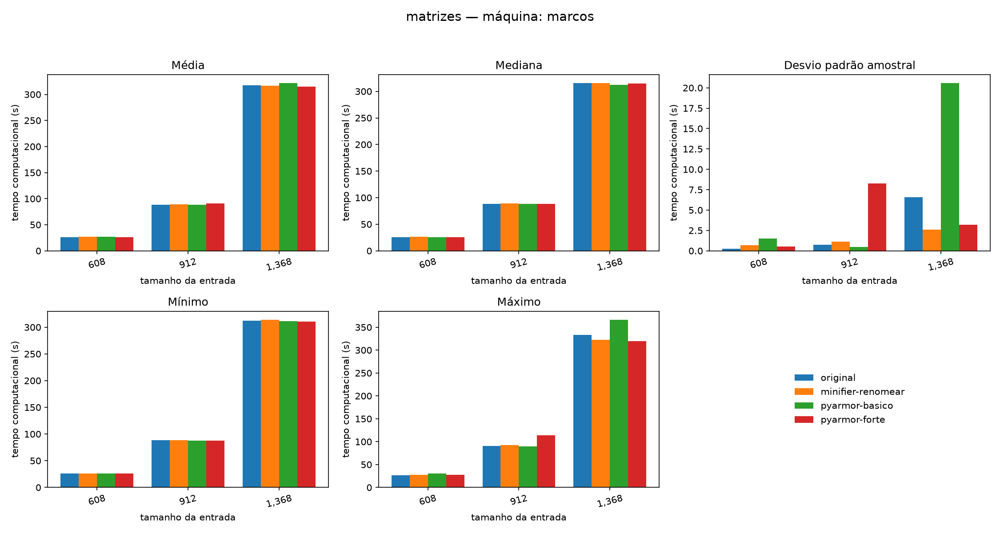
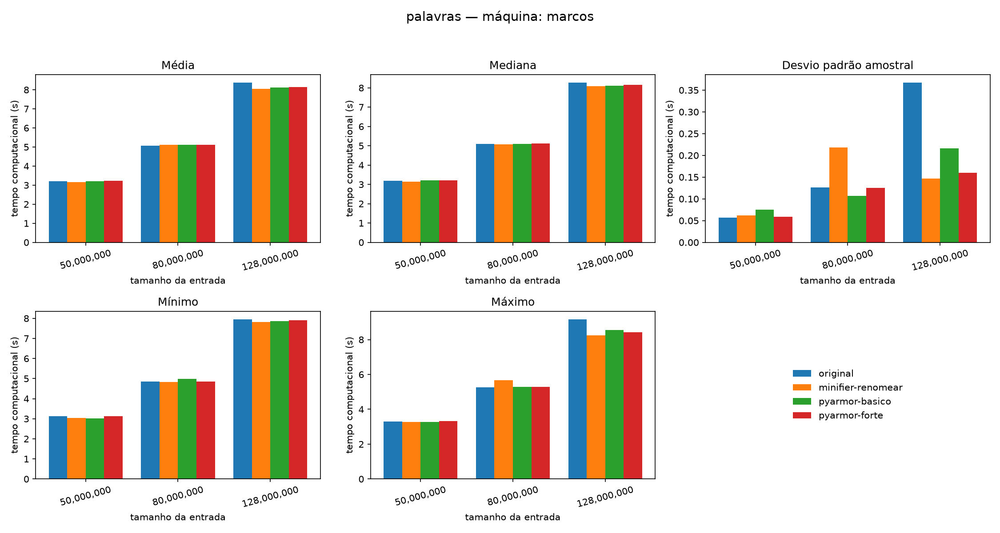

# Relatório — Trabalho IV: custo da ofuscação em Python

**Grupo:** _(nomes dos integrantes)_
**Data:** _(data)_

## 1. Ambiente de teste

_Uma subseção por máquina: cole o conteúdo de `resultados/<id>/sistema.md` (SO + versão, CPU, memória,
governor, energia, Python, versões dos ofuscadores) de cada integrante.
Informe também: programas fechados? suspensão desativada? tamanhos ajustados (`ajustes_por_maquina`)?_

### marcos
### pedro

Windows 10 build 19045, Intel Core i7-9700, 8 núcleos/8 threads, 31,9 GiB de RAM,
CPython 3.12.15, PyArmor 9.2.8 trial e python-minifier 3.4.0.
A primeira rodada usou os tamanhos globais e o plano de alto desempenho do Windows;
a frequência efetiva não foi registrada durante essa rodada. Tomada, programas
fechados, suspensão desativada e ausência de uso foram confirmados pelo participante.
Ambiente detalhado: [sistema.md](../resultados/pedro/sistema.md).

Uma repetição com perfil limitado a 1200 MHz e outros tamanhos foi preparada e
testada em sondas, mas **não foi iniciada**: em 29/10 o participante pediu deixar
para depois. As estatísticas existentes pertencem à primeira rodada.

### _(id do integrante 3)_

## 2. Benchmarks

- **Matrizes:** multiplicação n×n com 3 laços aninhados; custo O(n³).
- **Palavras:** contagem de frequência em dicionário; custo O(n).

## 3. Configurações de ofuscação

| Config | Ferramenta/versão | Comando | Técnicas aplicadas |
|---|---|---|---|
| original | — | — | — |
| | | | |

## 4. Metodologia

_Complementar os tamanhos e o controle de cada plataforma, identificando Python,
perfil de energia e ajustes por máquina (ver [GUIA-GRUPO.md](GUIA-GRUPO.md))._

O tempo adotado é o `time: X seconds` do próprio programa, que mede a parte
computacional. O tempo total do processo inclui construir a entrada. A exigência
de 20 s deve ser conferida nos dois originais em cada máquina/perfil; os tamanhos
globais e o “tudo certo” do verificador não garantem esse resultado. Documentar
uma duração menor não representa dispensa do requisito.

O [registro de achados e decisões](DECISOES-EXPERIMENTO.md) documenta a pendência,
as evidências, a preparação da repetição e as regras de comparação entre máquinas.
A alteração de frequência preparada para pedro é uma condição experimental
específica; ela não deve ser aplicada automaticamente às demais máquinas.

## 5. Resultados

_Para cada máquina, inclua `resultados/<id>/tabelas.md` e os gráficos de
`resultados/<id>/graficos/`. Depois inclua a comparação (`resultados/comparacao.md`)._

**Pedro — primeira rodada, com pendência de duração em palavras:**
240 execuções com saída correta e retorno zero, dez repetições por caso,
concluídas em 29/10 às 04h31. Em matrizes n=560, o original levou
26,263–28,106 s. Em palavras, as médias do original foram 4,316 s, 6,980 s e
10,924 s para 50M, 80M e 128M. Portanto, essa rodada não atende integralmente
ao requisito de duração. Consulte [tabelas](../resultados/pedro/tabelas.md),
[gráfico de matrizes](../resultados/pedro/graficos/matrizes.png) e
[gráfico de palavras](../resultados/pedro/graficos/palavras.png).

As sondas de preparação a 1200 MHz produziram 32,112 s em matrizes n=360 e
32,874 s em palavras n=96M, com saída correta. São execuções isoladas, sem
as dez repetições: não substituem a rodada completa nem a estatística final.

## 6. Análise

- O custo é linear com a entrada? Por quê?
- Qual técnica teve maior impacto? Em qual benchmark?
- Tempo de inicialização vs. tempo de computação (compare `tempo_interno_s` e `tempo_total_s`).
- Trade-off segurança × desempenho.
- O custo relativo (slowdown) é parecido entre as três máquinas? O que explicaria diferenças (CPU, SO, versão do Python)?

## 7. Dificuldades e decisões

- Problemas de instalação (por máquina):
- O que não funcionou de maneira alguma: PyArmor trial recusa `--obf-code 2`, `--mix-str`,
  `--enable rft|bcc` (`out of license`); `pyarmor-forte` usa só opções aceitas pela trial.
- Tamanhos do `palavras` limitados pela RAM (< 20 s no original):
- Decisões tomadas:

Na máquina de pedro, a instalação terminou com o aviso
`WARNING: Cache entry deserialization failed, entry ignored`; a instalação e
os testes funcionais subsequentes passaram. O problema metodológico foi
descoberto após a rodada: o verificador estima 20 s apenas para matrizes e
não verifica a duração de palavras. A pendência deveria ter sido explicitada
antes da primeira medição longa.

Aumentar apenas as entradas no perfil original exigiria, por extrapolação,
aproximadamente 234M, 352M e 527M palavras. O maior caso precisaria de 34,4 GiB
livres usando a estimativa do projeto e 25% de folga, acima da RAM total da
máquina. As sondas posteriores também mostraram que o pico real pode exceder
a estimativa de 56 bytes/palavra. Por isso foi preparado outro perfil de CPU,
com os originais preservados e a repetição integral dos dois benchmarks.

No perfil preparado de 1200 MHz, a sonda de 216M palavras teve pico residente
de 12,63 GiB e mínimo livre de 4,02 GiB. A rodada completa desse perfil permanece
pendente. Erros das tentativas, evidências e critérios estão no
[protocolo de pedro](../resultados/pedro/protocolo-correcao.md).

## 8. Extras (se feitos)

- Outros sistemas (as três máquinas):
- Outras configurações/tamanhos:
- Regiões equivalentes entre original e ofuscado:
